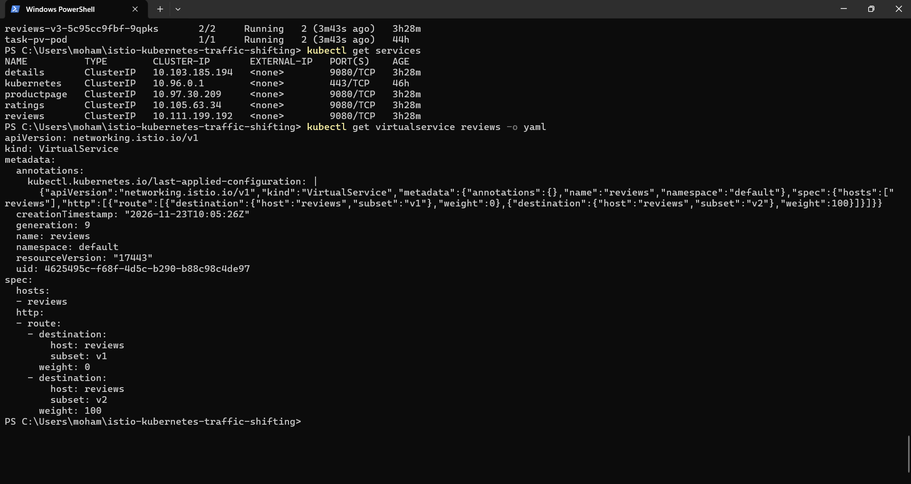
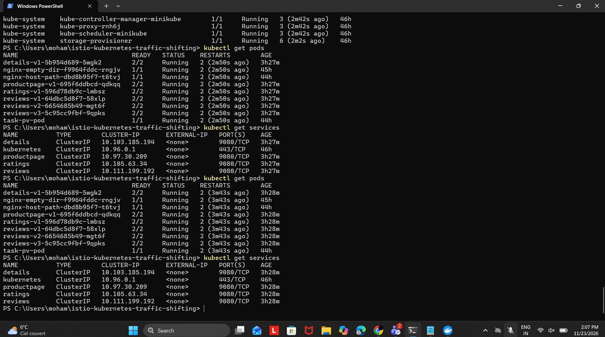
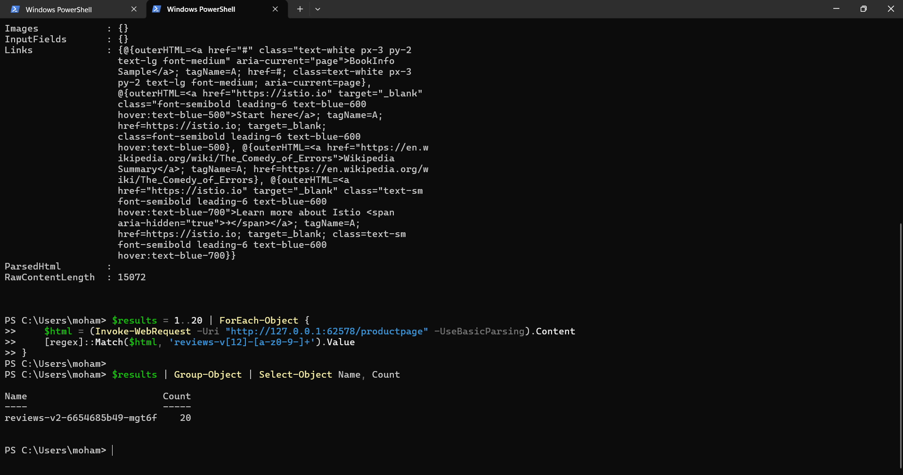
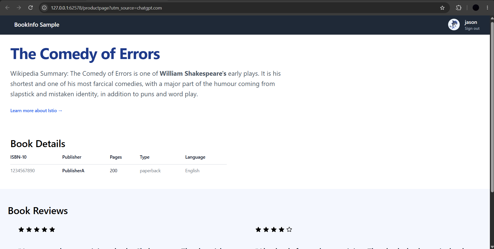

# Istio Kubernetes Traffic Shifting

[](https://kubernetes.io/)
[](https://istio.io/)
[](https://minikube.sigs.k8s.io/)

## Project Overview

This project demonstrates traffic management using **Istio and Kubernetes** through the Bookinfo sample application.

The objective is to implement traffic shifting between two versions of the Reviews service using Istio VirtualServices and weighted routing.

The project explores how traffic can be gradually redirected from one application version to another, a technique commonly used in Canary Deployments.

## Technologies Used

- Kubernetes
- Minikube
- Istio Service Mesh
- YAML
- PowerShell
- Git and GitHub

## Project Objectives

- Understand Istio VirtualServices and DestinationRules.
- Configure traffic routing between application versions.
- Implement weighted traffic shifting.
- Test traffic distribution using HTTP requests.
- Understand Canary Deployments.

## Architecture Overview

The Bookinfo application runs on a local Kubernetes cluster managed by Minikube.

Istio manages incoming application traffic through its Ingress Gateway and VirtualService.

The VirtualService routes requests to different Reviews service subsets according to their configured traffic weights.

```text
                 User / Browser
                       |
                       v
              Istio Ingress Gateway
                       |
                       v
                VirtualService
                       |
              Reviews Service
                       |
              +--------+--------+
              |                 |
              v                 v
          Reviews v1        Reviews v2
           (Subset)          (Subset)
```

A DestinationRule defines the application subsets used by the VirtualService.

## Traffic Shifting Implementation

Traffic was progressively shifted between Reviews v1 and Reviews v2.

| Stage | Reviews v1 | Reviews v2 |
|---|---:|---:|
| 1 | 80% | 20% |
| 2 | 50% | 50% |
| 3 | 20% | 80% |
| 4 | 0% | 100% |

This demonstrates how Istio can gradually introduce a new application version without immediately directing all traffic to it.

## Testing and Validation

Traffic distribution was tested by sending **20 HTTP requests** to the Bookinfo product page through the Istio Ingress Gateway.

PowerShell was used to send requests and identify the Reviews version returned in each response.

### Final Test Result

| Reviews Version | Requests | Observed Distribution |
|---|---:|---:|
| Reviews v1 | 0 | 0% |
| Reviews v2 | 20 | 100% |
| **Total** | **20** | **100%** |

All 20 requests in the final test were served by Reviews v2, matching the configured 0% v1 / 100% v2 traffic weights.

## Screenshots

### 1. Kubernetes Environment

Shows the running Bookinfo pods and Kubernetes services.



### 2. Istio VirtualService Configuration

Shows the final weighted routing configuration: 0% to Reviews v1 and 100% to Reviews v2.



### 3. Traffic Shifting Test

Shows the result of the 20 HTTP requests, with all requests reaching Reviews v2.



### 4. Bookinfo Application

Shows the Bookinfo sample application running through the Istio Ingress Gateway.



## Project Structure

```text
istio-kubernetes-traffic-shifting/
│
├── manifests/
│   ├── reviews-routing.yaml
│   ├── reviews-traffic-shifting.yaml
│   ├── reviews-traffic-shifting-20-80.yaml
│   ├── reviews-traffic-shifting-50-50.yaml
│   ├── reviews-traffic-shifting-0-100.yaml
│   └── reviews-v1.yaml
│
├── screenshots/
│   ├── 01-kubernetes-environment.png
│   ├── 02-istio-virtualservice.png
│   ├── 03-traffic-shifting-test.png
│   └── 04-bookinfo-application.png
│
└── README.md
```

## How Traffic Shifting Works

An Istio VirtualService defines how traffic is routed to different service subsets.

A DestinationRule defines subsets such as v1 and v2 using Kubernetes workload labels.

Traffic weights determine the proportion of requests routed to each subset.

This technique is commonly used in Canary Deployments to gradually introduce a new application version.

## Skills Demonstrated

- Kubernetes application deployment and management.
- Istio service mesh configuration.
- YAML-based infrastructure configuration.
- VirtualService and DestinationRule concepts.
- Weighted traffic routing.
- HTTP testing using PowerShell.
- Git version control and GitHub project documentation.

## Author

**Mohamed Ramalaawie**

MSc Data Engineering for Artificial Intelligence

Data ScienceTech Institute (DSTI), France